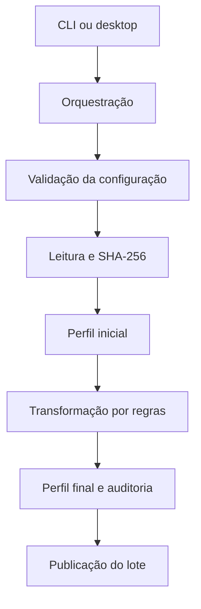

# Arquitetura e decisões

## Fluxo de execução

## Fronteiras

As interfaces coletam parâmetros; não implementam regras de dados. A orquestração chama leitores, profiler, transformador e exportador. Ingestão não transforma datas nem números. O transformador opera sobre uma cópia do DataFrame e retorna auditoria. O exportador é o único componente que grava o lote final.

A API interna principal é `dataforge.orchestration.pipeline.run(source, output, config, **read_options)`. Retorna o relatório após publicar o lote; falhas levantam exceção. A CLI retorna 1 em falha e 0 em conclusão, inclusive com avisos de conversão. Consumidores devem conferir `status` para distinguir avisos.

## Publicação

O exportador cria um lock exclusivo no diretório pai, grava em uma pasta temporária no mesmo sistema de arquivos e renomeia para a pasta final. Duas execuções DataForge com o mesmo destino não podem publicar simultaneamente. O lock não coordena aplicações externas que escrevam na mesma pasta; o diretório de destino deve ser dedicado ao pipeline.

Falhas normais removem a pasta temporária e o lock da execução. Em encerramento forçado do processo pode sobrar lock/pasta temporária. Consulte o manual de operação antes de removê-los. A publicação pressupõe semântica de rename do sistema de arquivos local; não oferece transação em sistemas de objetos ou garantias equivalentes em todos os compartilhamentos de rede.

## Rastreabilidade

Cada execução recebe UUID. Fingerprint SHA-256 da origem é calculado em blocos, antes e após a leitura. Mudança detectada interrompe o processamento. Isso reduz o risco de processar um arquivo em edição; a prática recomendada continua sendo fornecer uma cópia estável.

Relatórios não incluem amostras dos valores, mas expõem nome do arquivo, nomes das colunas, configuração e estatísticas. O CSV de saída contém os dados tratados.

## Por que não inferir tudo

Uma coluna numérica pode ser identificador e uma duplicata pode representar eventos legítimos. Nenhuma regra de negócio é presumida. Datas exigem formato; números exigem separadores. Conversões recusadas mantêm a coluna em texto em vez de descartar valores.

## Extensão

Novos formatos devem entrar na ingestão, novas métricas em qualidade e novas regras no contrato de configuração e no transformador, sempre acompanhadas de testes de comportamento. Integrações com bancos e IA são extensões futuras; as pastas atuais contêm somente componentes utilizados pelo pipeline.
